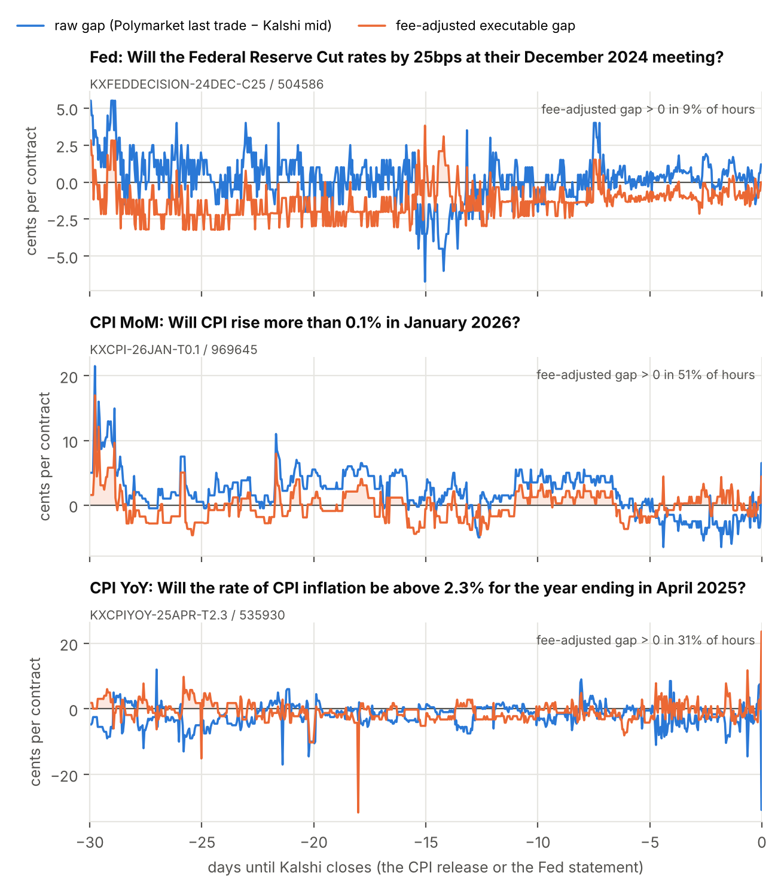
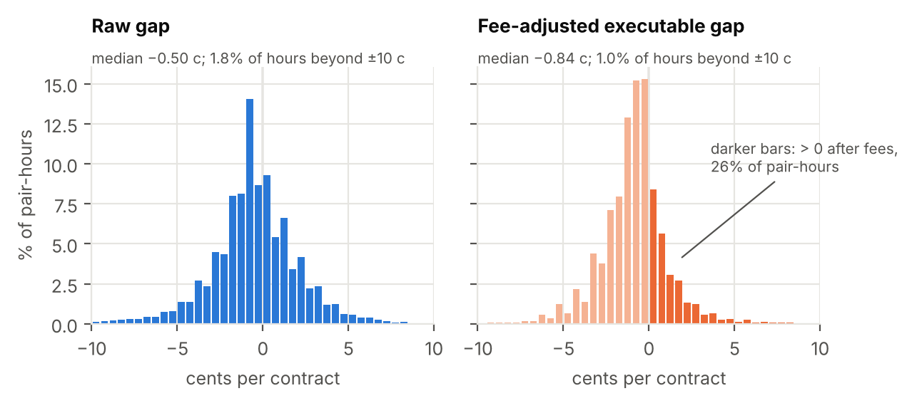
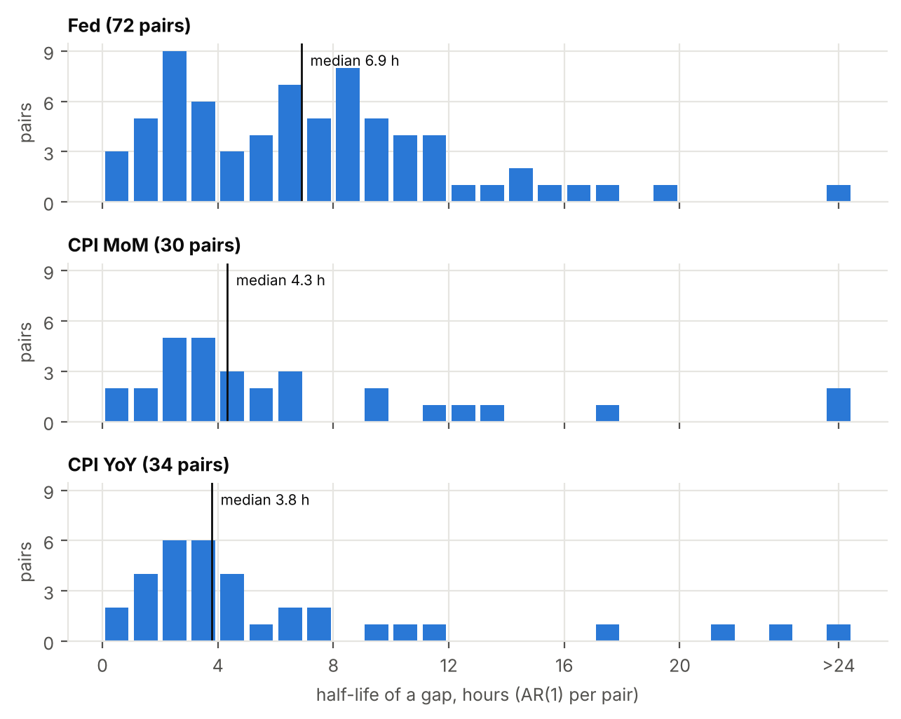

# Cross-venue arbitrage between Kalshi and Polymarket

When the same event trades on two prediction markets, do the prices differ,
and are the differences real arbitrage after fees? This project matches US
Fed-decision and CPI-inflation contracts on Kalshi and Polymarket and finds
**155 verified cross-venue pairs** (November 2024 to November 2026). After
both venues' taker fees, **26% of usable pair-hours show a positive
executable-style gap, typically 0.87 cents per $1 contract** (median of the
positive gaps), an upper bound because Polymarket's historical ask has to be
estimated. Gaps are short-lived: **a gap halves in about 5 hours** (median
across pairs). In **Fed markets, Kalshi tends to lead price discovery**: its
price changes predict Polymarket's in 28% of Fed pairs, against 13% the other
way round. Resolution risk is real: **3 of 177 settled candidate pairs paid
differently** on the two venues, and covering such losses would take more
than the typical gap. The best live opportunity found in the order books of
4 November 2026 shows the scale: **$1.82 profit on $8,264 of capital over
35 days** (0.23% a year).

Live order-book data collection ongoing until December 2026.



## Research question

Prediction markets price binary contracts that pay $1 if an event happens.
If two venues list the *same* contract, the law of one price says their
prices should be equal, up to trading costs. The project asks:

1. How often, and by how much, do Kalshi and Polymarket prices for the same
   outcome differ, before and after fees?
2. How long do the differences last, and what makes them large?
3. Which venue moves first when news arrives?
4. Are "identical" contracts really identical, that is, do they always pay
   the same? If not, what does that do to the apparent arbitrage?

## Data sources

All data come from **public, unauthenticated GET endpoints**: no account, no
API keys, no orders. Requests are throttled to at most 5 per second, retried
with backoff on 429 and 5xx errors, and cached during a session.

| Venue | API | What we use |
|---|---|---|
| Kalshi (CFTC-regulated exchange) | `https://external-api.kalshi.com/trade-api/v2` | market rules and results, hourly candles with best bid and ask (1,837,894 candles), order-book snapshots |
| Polymarket | Gamma API `https://gamma-api.polymarket.com` | market rules, results and fee schedules |
| Polymarket | CLOB API `https://clob.polymarket.com` | order-book snapshots, price history (607,341 points) |
| Polymarket | Data API `https://data-api.polymarket.com` | every trade of the paired markets (2,246,500 trades, aggregated into 203,638 hourly bars); trader identities are dropped on arrival |

Sample: Kalshi series `KXFEDDECISION` (Fed decision), `KXFED` (Fed rate
level), `KXCPI` (CPI month-on-month) and `KXCPIYOY` (CPI year-on-year), and
the matching Polymarket events, for every market that closes on or after the
date 24 months before the download (4 November 2026), settled or still open.
All timestamps are UTC; prices are dollars between 0 and 1.

## Method

**1. Matching and two-pass verification** (`src/match.py`,
`src/apply_independent_review.py`, `src/build_pairs.py`;
[docs/matching.md](docs/matching.md)). Titles are a poor guide: right and
wrong pairs have almost the same median title similarity (68 and 67 out of 100). Instead, each market's
*key fields* are read from its rules: what is measured (headline CPI-U
month-on-month, the change in the Fed's upper bound, ...), the month or
meeting, and the exact set of values for which YES pays, counted in whole
steps of the published precision (0.1 percentage point for CPI, 25 bp for
the Fed). Of 16,713 compared pairs, 201 are candidates with identical or
exactly complementary outcomes. Every candidate's rules are compared and
differences are flagged. Then a blind second review of every pair is
combined cautiously with the code's suggestion ("same" only if both say
same); the two passes agree on 192 of 201 pairs. Result: **155 verified
pairs** (76 Fed, 37 CPI MoM, 42 CPI YoY), 43 unsure, 3 different.

**2. Fees** (`src/arb.py`; [docs/arbitrage.md](docs/arbitrage.md)). An
arbitrageur buys offers already in the book, so both legs pay the **taker
fee**, each from the venue's official formula, cited in the code and unit
tested against the venue's own examples:
Kalshi 0.07 × P × (1 − P) per contract, with cost plus fee rounded up to
$0.0001 per order;
Polymarket feeRate × p × (1 − p) per share from each market's own fee
schedule, zero before 30 March 2026. The worked example walks down both
order books to the profit-maximising size.

**3. Historical gaps** (`src/gaps.py`,
[notebooks/01_historical_gaps.ipynb](notebooks/01_historical_gaps.ipynb)).
Both venues are put on one hourly UTC grid, up to the last full hour before
Kalshi closes (just before the news). The **raw gap** is Polymarket's last
trade minus Kalshi's mid. The **executable-style gap** is the profit per
contract of the better of the two hedged positions (YES on one venue + NO on
the other), buying at Kalshi's real ask and at Polymarket's last trade plus
half a typical spread (0.5 cents), minus both taker fees in force at that
hour. Statistics: shares and medians by topic and horizon, AR(1) half-lives
per pair, an OLS regression of the absolute gap with standard errors
clustered by pair, and Granger causality tests per pair.

**4. Resolution risk** (notebook part 7). The 155 verified pairs were checked
using their realised settlements, so pairs that paid differently were
removed *after the fact*. Part 7 therefore goes back to all **177 candidate
pairs settled on both venues** and asks what a trader who entered every
positive gap would actually have earned.

## Main results

Full tables: [docs/results.md](docs/results.md). A short paper:
[docs/paper.md](docs/paper.md).

| | Fed | CPI MoM | CPI YoY | all |
|---|---|---|---|---|
| pairs in the main sample | 76 | 36 | 41 | 153 |
| pair-hours | 124,043 | 16,834 | 22,060 | 162,937 |
| share of hours with a positive gap after fees | 20.2% | 42.5% | 43.0% | 25.6% |
| median positive gap after fees (cents) | 0.76 | 1.14 | 1.15 | 0.87 |
| median half-life of a gap (hours) | 6.9 | 4.3 | 3.8 | 5.3 |
| Granger: Kalshi leads / Polymarket leads | 27.9% / 13.1% | 10.7% / 14.3% | 15.2% / 6.1% | 20.5% / 11.5% |

* **Profitable-looking hours are common but tiny.** The 26% share depends
  mostly on the assumed Polymarket spread: from 41% with no spread to 17%
  with a half spread of 1 cent. After Polymarket introduced fees on these
  markets (30 March 2026), the share fell from 29% to 20%.
* **Gaps close within hours.** With fresh Polymarket prices only, the median
  half-life falls to 2.6 hours; a pooled AR(1) with pair fixed effects gives
  ρ = 0.892 (half-life 6.1 hours).
* **Determinants.** Gaps are smaller near prices of 0 or 1 (−0.050 cents per
  cent of distance from 0.5) and larger in CPI markets (+1.06 and +1.61 cents
  compared with the Fed). More Polymarket volume goes with smaller gaps once
  outliers are capped.
* **Resolution risk eats the profit.** 3 of 177 settled pairs paid
  differently (1.7%; 95% confidence interval 0.4% to 4.9%): one through the
  October 2025 government shutdown, when the BLS published no October CPI
  and the venues settled on different values, and two through a faulty
  duplicate Polymarket event for the September 2026 Fed meeting. All three
  showed a positive fee-adjusted gap at the last moment both venues had
  prices. A trader entering every
  settled pair with a positive gap at that moment (32 pairs, one contract
  each) would have earned **$0.25 instead of the $1.25** the gaps promised.
  Covering such losses needs about 1.32 cents per normal trade, more than
  the typical positive gap of 0.87 cents.





## Limitations

1. **Polymarket's executable price is estimated.** There is no historical
   Polymarket order book, only trades, so the ask is the last trade plus half
   a spread taken from one snapshot. Choosing the better of two directions
   also picks up measurement error. The fee-adjusted gap is an **upper
   bound**.
2. **No size.** Kalshi's candles have the best quotes but not the number of
   contracts at them.
3. **Hourly timing.** Moves within the hour and leads of a few minutes are
   invisible.
4. **Selection on the outcome.** The verified pairs were selected using
   realised settlements, so the main results understate the resolution risk
   traders faced; part 7 corrects for this.
5. **Few divergences.** The resolution-risk estimate rests on 3 divergent
   pairs, two from the same faulty event.
6. **Fees and costs.** Kalshi's formula is assumed constant over the sample;
   Polymarket's current schedules are assumed to apply from 30 March 2026.
   Deposit and withdrawal costs and the interest on locked-up capital are not
   included.
7. **Associations, not causes.** The regression and the Granger tests
   describe what goes together and what predicts what.

The live order-book snapshots (`src/snapshot.py`, every 5 minutes, both
venues within about 0.05 seconds) address limitations 1 to 3 and are being
collected until December 2026.

## Getting the data

**This repository contains almost no data.** The only file from `data/` that is
published is the review file described below (`.gitignore` excludes the rest). The scripts download everything from the
venues' public APIs; no account or API key is needed. `python run_all.py`
(below) runs all download steps in order, or run them by hand:

```bash
python src/download_kalshi.py         # -> data/processed/kalshi_*.parquet
python src/download_polymarket.py     # -> data/processed/poly_markets, poly_orderbooks, poly_prices
python src/download_poly_trades.py    # -> data/processed/poly_trade_bars.parquet (after the pairs exist)
```

Raw API answers are cached in `data/raw/`, so an interrupted download
continues where it stopped. Expect a few hours, mostly because Kalshi limits
how fast it answers. The downloads keep the markets of the 24 months before
the day you run them, so your sample will differ somewhat from the one
behind the numbers above (downloaded on 4 November 2026).

**The review file is included.** The first pass of the two-pass
verification is a reviewer's judgement on each candidate pair, which no
script can download. It is published as
`data/processed/independent_review.csv`: one row per candidate pair of
4 November 2026 (201 rows: `pair_id`, `verdict`, `reason`), so anyone can read
every verdict and its reason, and `src/apply_independent_review.py` turns it
into the 155 verified pairs.

The file covers exactly the 201 candidates of 4 November 2026, and
`apply_independent_review.py` stops if your candidates differ. A later
download sees newer markets (and drops the oldest), so its candidates will
usually differ. Then review the candidates yourself:
`python src/make_review_sheet.py` writes an Excel sheet; fill in `same` /
`different` / `unsure` (the published reasons show how each kind of pair was
judged), save it, and run `python src/read_review_sheet.py`. Then continue
with `python run_all.py --from pairs`. `docs/matching.md` explains what to
check.

## How to reproduce everything

Python 3.12 or newer (the pinned numpy needs it). From the project folder:

```bash
pip install -r requirements.txt
```

```bash
pytest
```

Everything from scratch, downloads included (a few hours, mostly Kalshi's
rate limits). If your candidates differ from the 201 of 4 November 2026, the
run stops at the `verify` step and explains how to review them (see "Getting
the data"):

```bash
python run_all.py
```

Once the tables exist in `data/processed/`, rebuild the analysis without
downloading again (a few minutes):

```bash
python run_all.py --no-download
```
`run_all.py` never overwrites work typed by hand: a filled-in spot check
(`spot_check.xlsx`) or your own review is kept. `python run_all.py --list`
shows the steps; `--from STEP` restarts at one.

The same steps by hand, in order:

```bash
python src/check_connection.py        # can we reach both venues' APIs?
python src/download_kalshi.py         # Kalshi markets, order books, hourly candles
python src/download_polymarket.py     # Polymarket markets, order books, price history
python src/match.py                   # candidate pairs -> match_candidates.csv
python src/apply_independent_review.py   # two-pass verification with the published review file
python src/build_pairs.py             # verified pairs -> pairs.parquet
python src/download_poly_trades.py    # Polymarket trades of the pairs -> hourly bars
python src/arb.py                     # worked fee example (arb.py --download for fresh books)
jupyter nbconvert --to notebook --execute --inplace notebooks/01_historical_gaps.ipynb
```

Live order-book collection (runs until stopped; see
[docs/snapshot.md](docs/snapshot.md)):

```bash
python src/snapshot.py
```

## Repository layout

| Folder | Contents |
|---|---|
| `src/` | Python code: API clients, downloads, matching, verification, fees, gaps, live snapshots |
| `tests/` | unit tests (`pytest`), including every fee and price formula |
| `notebooks/` | `01_historical_gaps.ipynb`: the whole analysis |
| `figures/` | the three figures (PNG and PDF) |
| `docs/` | [paper](docs/paper.md), [results](docs/results.md), [matching](docs/matching.md), [fees and arbitrage](docs/arbitrage.md), [Polymarket trades](docs/poly_trades.md), [snapshots](docs/snapshot.md), [code walkthrough](docs/code_walkthrough.md) |
| `data/` | created by the scripts (`data/raw/` cache, `data/processed/` clean Parquet tables); only `data/processed/independent_review.csv` is in this repository |
| `run_all.py` | rebuilds everything in order |

## Research only

This is an independent research project in economics. It only reads public
market data; it never places orders, creates accounts or uses keys or
wallets. Nothing here is investment advice.

## License

MIT, see [LICENSE](LICENSE).
