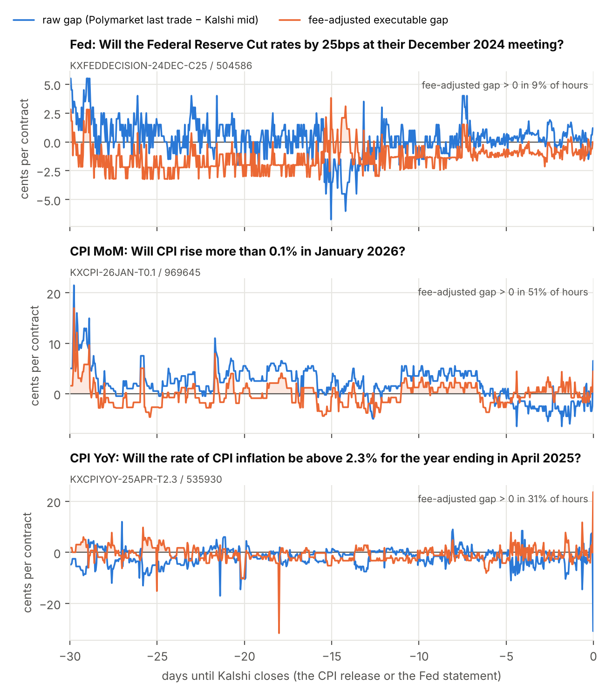
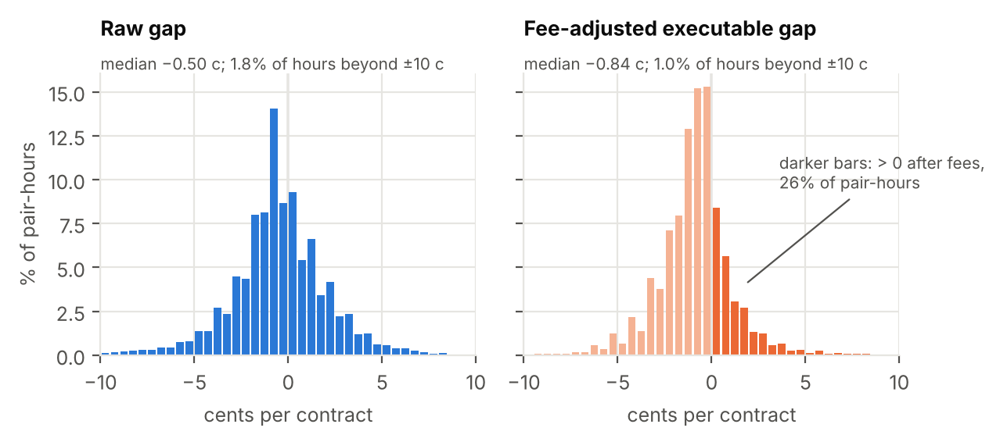
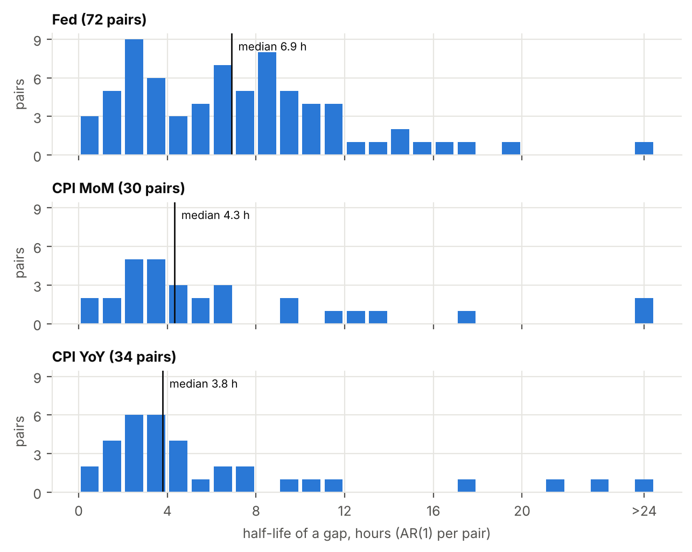

# Same event, two prices: cross-venue arbitrage between Kalshi and Polymarket

*[Author name]* · Master's thesis project in economics · November 2026

**Abstract.** I match Fed-decision and CPI contracts on Kalshi and
Polymarket by their economic content, verify the pairs in a two-pass review,
and obtain 155 verified pairs (November 2024 to November 2026). In 162,937
usable pair-hours, an executable-style gap is positive after both venues'
taker fees in 26% of hours, typically 0.87 cents per $1 contract, an upper
bound. Gaps halve in about 5 hours, are larger in CPI than in Fed markets,
and in Fed markets Kalshi tends to move first. Identical-looking contracts
do not always pay the same: 3 of 177 pairs settled on both venues paid
differently, turning the $1.25 that a gap-trader's positions promised into
$0.25. Because the verified pairs were selected using realised settlements,
the main results understate the risk traders faced; Section 7 corrects for
this. The gaps look like a near no-arbitrage band set by fees, resolution
risk and capital lock-up, not free money.

---

## 1. Introduction

A prediction-market contract pays $1 if an event happens and nothing
otherwise. When two venues list the *same* contract, the law of one price
says their prices should differ by no more than the cost of trading between
them. If they differ by more, buying YES on one venue and NO on the other
pays exactly $1 whatever happens, for less than $1. This paper asks how
often such gaps arise between Kalshi, a CFTC-regulated US exchange, and
Polymarket, a crypto-funded venue, and whether they survive the frictions an
arbitrageur faces.

Two features make the question harder than it looks. First, "the same
contract" must be established, not assumed: each venue writes its own rules
and fallback provisions, and a pair that looks identical can pay differently
when something unusual happens. Second, a price difference is a profit only
at executable prices, net of both fees, and when both prices are current.

I restrict the sample to Fed rate decisions and US CPI releases (month-on-
month and year-on-year): scheduled events, settled on official statistics
and listed on both venues as families of numeric thresholds, so every
payoff can be written as a set of outcomes and compared exactly.

The paper contributes (i) a matching procedure based on each market's key
fields, with a two-pass verification; (ii) gaps net of both venues' official
taker fees, as in force at each hour; (iii) hourly evidence on how often gaps
appear, how long they last, what makes them large and which venue moves
first; and (iv) a direct measurement of resolution risk.

One limitation must be stated at the outset. The 155 verified pairs were
selected using their realised settlements: pairs that paid differently were
rejected as "different" *after the fact*. A trader at the time could not
have done this. The main results (Sections 6.1 to 6.4) therefore describe
the pairs that turned out well and understate the risk traders faced.
Section 7 corrects for this by going back to all 177 candidate pairs settled
on both venues.

## 2. Related work

The closest study is Saguillo, Ghafouri, Kiffer and Suarez-Tangil (2025),
"Unravelling the Probabilistic Forest: Arbitrage in Prediction Markets"
(arXiv:2508.03474, AFT 2025). Using on-chain data, they study arbitrage
*within* Polymarket: market rebalancing arbitrage inside a single market or
condition, and combinatorial arbitrage across logically related markets,
found with heuristics based on timing, topic and logical relationships. They
estimate that about 40 million US dollars of profit was realised through
these trades. This paper is complementary. It studies arbitrage *across* two venues with separate
rulebooks, order books and fee schedules, where the main difficulty is not
finding related markets on one venue but establishing that two
independently written contracts are the same, and it adds the risk that two
such contracts settle differently.

The economic framing comes from the limits-to-arbitrage literature
(Shleifer and Vishny, 1997): mispricing can persist when exploiting it is
costly or risky. Here the costs are trading fees and capital that stays
locked until settlement, and the risk is that the two legs do not pay the
same. On prediction markets as forecasting tools, see Wolfers and Zitzewitz
(2004). The price-discovery analysis uses Granger (1969) causality tests,
in the spirit of the literature on one asset trading in several markets
(Hasbrouck, 1995), but at the hourly frequency that the data allow.

## 3. Data

All data come from public, unauthenticated endpoints of the two venues'
APIs; no account or key is used and no order is placed. Requests are
throttled to at most five per second and cached. The download of
4 November 2026 keeps every market that closes on or after the date
24 months earlier, settled or still open.

**Kalshi.** Four series: `KXFEDDECISION` (the decision at each meeting),
`KXFED` (the rate level after it), `KXCPI` and `KXCPIYOY`. For every market:
the rules, the result, hourly candles with the closing best bid and ask, last
trade and volume (1,837,894 candles), and an order-book snapshot if open.

**Polymarket.** The Fed-decision and CPI events: rules, results, each
market's own fee schedule, order-book snapshots and price history (607,341
points). For the 155 paired markets, every trade (2,246,500, aggregated into
203,638 hourly bars; trader identities are dropped on arrival). Summed trade
sizes match Polymarket's reported volume within 0.5% for 137 of 150
markets.

**The hourly panel.** For each pair, both venues are placed on one hourly
UTC grid, from the first hour in which both have a price to the last full
hour *before Kalshi closes*. Kalshi closes its markets one minute before the
8:30 AM ET CPI release and a few minutes before the Fed's 2 PM ET statement;
afterwards, Polymarket's price already knows the result. Kalshi's quote at each hour is the last
candle, carried forward; Polymarket's price is the latest trade of either
token, converted into the price of "Kalshi's YES happens" and carried
forward with its age. This gives 220,609 pair-hours. The **main sample** is
the 162,937 pair-hours (153 pairs) in which Kalshi has both a bid and an ask
and the Polymarket price is at most 24 hours old. As a cross-check,
Polymarket's own price series agrees with the trade-based prices with a
correlation of 0.999 and a median difference of 0.45 cents.

## 4. Matching and two-pass verification

**Key fields, not titles.** Title similarity cannot tell right pairs from
wrong ones: among pairs about the same question, the median title score
(0 to 100) is 68 for pairs with the same outcome and 67 for the others;
"Cut 25bps" and "Cut >25bps" both score 78 against "decrease 25 bps".
Instead, `src/match.py` reads from each market's title and rules what is
measured (headline CPI-U month-on-month or year-on-year, the change in the
Fed's upper bound, ...), the month or meeting, and the exact set of values
for which YES pays, counted in whole steps of the published precision. CPI is published
with one decimal, so Kalshi's "more than 0.2%" means "CPI ≥ 0.3%"; the Fed
moves in steps of 25 bp. A pair is a **candidate** if the two YES outcomes
are the same set, or exact complements (then the hedge is YES on both).

**Flags.** Of 16,713 compared pairs, 201 are candidates. For each, rule
and data differences are flagged and scored (different settlement values,
early-closing or duplicate Polymarket markets, different rules for a
cancelled meeting or postponed release, wrong dates), giving a suggested
verdict.

**Two passes.** In pass 1, a second reviewer read both full rules texts and
the settled results of every candidate *without* seeing the code's
suggestion or flags, and recorded a verdict and a one-line reason; these
were frozen before any comparison. In pass 2 the two verdicts are combined
cautiously: "same" only if both say same, otherwise "unsure" if either says
unsure, otherwise "different". The passes agreed on 192 of 201 pairs; all 9
disagreements are pairs that paid consistently but whose venues settled the
month or meeting on different values, and they end up "unsure". A random
human spot check of 10 "same" pairs (fixed seed) is kept for auditing.

**Result.** 155 pairs are "same" (76 Fed decision pairs over 21 meetings,
37 CPI MoM, 42 CPI YoY), 43 "unsure" (including all 36 level-against-change
pairs) and 3 "different". Of the 177 candidates settled on both venues, 174
paid the same.

## 5. Fees

An arbitrageur buys offers already in the book and therefore pays the
**taker fee on both legs**. Both formulas are implemented with exact decimal
arithmetic in `src/arb.py`, cite their official documentation, and are unit
tested against the venues' own examples.

* **Kalshi** (fee schedule effective 7 July 2026): fee =
  round up(M × 0.07 × C × P × (1 − P)) for C contracts at price P; the series
  multiplier M is 1 for all series here (checked through Kalshi's public
  API). Cost plus fee is rounded up to $0.0001 once per order.
* **Polymarket** (fees page and changelog): fee = C × feeRate × p × (1 − p),
  from each market's own schedule. Fees came to economics markets on
  **30 March 2026** and are zero before that date and for markets without a
  schedule (86 of the 155 paired markets; 60 have rate 0.05).

Both fees are proportional to P × (1 − P): at a price of 50 cents they reach
1.75 cents (Kalshi) and 1.25 cents (Polymarket at rate 0.05) per contract,
and they fall towards zero near 0 or 1. The gap needed for an arbitrage
therefore depends on the price level.

**A worked example.** In order books taken 0.72 seconds apart at 23:37 UTC
on 4 November 2026, the pair "Fed hikes 25 bp at the December 2026 meeting"
offered Kalshi NO at $0.20 and Polymarket YES at $0.78: a gross gap of
2 cents. The two taker fees took 1.978 cents, leaving 0.022 cents per
contract on 8,265.49 contracts, the size at which the next Kalshi price level
would have turned the trade into a loss. Total profit: **$1.82 on $8,264 of
capital, locked for 35 days**, 0.23% a year, far below what safe short-term
money earned at the time. The other two open example pairs lost about
2 cents per contract after fees.

## 6. Results

### 6.1 How often, and how large

The **raw gap** is Polymarket's last trade minus Kalshi's mid, both as the
price of "Kalshi's YES happens". It measures disagreement, not profit. The
**executable-style gap** is the profit per contract of the better of the two
hedged positions: buy Kalshi YES at Kalshi's ask and the opposite Polymarket
token, or Kalshi NO at one minus Kalshi's bid and the matching Polymarket
token; each Polymarket leg costs the last trade plus half a typical spread,
and both taker fees in force at that hour are subtracted. The half spread,
0.5 cents, is half the median spread (1 cent) of the 22 paired Polymarket
order books open on 4 November 2026.

| | Fed | CPI MoM | CPI YoY | all |
|---|---|---|---|---|
| pairs | 76 | 36 | 41 | 153 |
| pair-hours | 124,043 | 16,834 | 22,060 | 162,937 |
| share of hours with gap > 0 after fees | 20.2% | 42.5% | 43.0% | 25.6% |
| share of hours with gap > 1 cent after fees | 7.6% | 23.1% | 24.6% | 11.5% |
| median \|raw gap\| (cents) | 1.30 | 2.02 | 2.10 | 1.50 |
| median gap when > 0 (cents) | 0.76 | 1.14 | 1.15 | 0.87 |
| median annualised return when > 0 | 5.0% | 30.6% | 27.4% | 9.1% |

*Table 1. Main sample. Source: `docs/results.md`, parts 2-3.*

The raw gap is centred near zero (median −0.50 cents): neither venue is
systematically higher. Before fees, the executable gap is positive in 44% of
pair-hours; fees cut this to **26%**, and the typical positive gap is
**0.87 cents** per contract (Figure 2). The fee-adjusted gap itself has a
median of −0.84 cents and a 95th percentile of 2.26 cents. Polymarket's fees
matter: the share of positive hours was 29% before 30 March 2026 and 20%
afterwards.

The share depends mostly on the assumed Polymarket spread (41% with no
spread, 17% with a half spread of 1 cent), hardly on how fresh the price must
be (25% at most 1 hour old, 26% at 24 hours). Choosing the better of two
directions picks up any error in the estimated ask that looks profitable, so
the executable-style gap is an **upper bound**, most of all in thin CPI
markets, whose real spreads were likely wider than 1 cent.

Gaps shrink near resolution in Fed markets (9.0% of Fed hours are positive
in the last day) but not in CPI markets. The largest gaps, of 50 cents or
more, come from single tiny Polymarket trades far from the market; medians
and shares limit their influence.

*Figure 1. Raw and fee-adjusted gap in the last 30 days of one pair per
topic, chosen by a fixed rule (the settled pair with the most main-sample
hours among those whose Kalshi mid averaged 20 to 80 cents). The shaded
areas mark hours with a positive fee-adjusted gap.*

*Figure 2. Distribution of raw and fee-adjusted gaps over all main-sample
pair-hours, in half-cent bins; gaps beyond ±10 cents are cut from the
picture but not from the statistics.*

### 6.2 Persistence

For each pair with at least 100 pairs of neighbouring hours (136 pairs) I
estimate an AR(1) on the hourly raw gap, gap(t) = a + ρ·gap(t−1) + ε(t), by
OLS. A deviation from the pair's long-run average shrinks to ρ^h after
h hours, so its half-life is ln(0.5)/ln(ρ). Two neighbouring hours are used
only if both are in the main sample, so a hole in the data never makes
distant hours look like neighbours.

The median ρ is 0.88 and the **median half-life 5.3 hours** (Fed 6.9,
CPI MoM 4.3, CPI YoY 3.8; Figure 3). Only 2.9% of pairs have half-lives
above a day. With fresh Polymarket prices only (less than one hour old) the
median half-life falls to 2.6 hours, so part of the measured persistence is
staleness: the Polymarket price simply had not been updated. A pooled AR(1)
with pair fixed effects gives ρ = 0.892 (standard error 0.015, clustered by
pair), a half-life of 6.1 hours, in line with the pair-by-pair medians.
Gaps close within the same day, so exploiting them requires watching both
venues continuously.

*Figure 3. Half-lives of the gaps, AR(1) per pair, by topic; half-lives
above 24 hours are collected in the last bar.*

### 6.3 Determinants

I regress the absolute raw gap (cents) on log 24-hour volume on each venue,
log(1 + days to resolution), the distance of the average price from 0.5
(cents), and topic dummies, with standard errors clustered by pair (153
clusters), because the hours of one pair are not independent draws.

| | (1) main | (2) + controls | (3) capped at p99 |
|---|---|---|---|
| log Kalshi volume (24 h) | −0.042 | 0.088\*\*\* | −0.010 |
| log Polymarket volume (24 h) | −0.081\* | −0.101\*\*\* | −0.094\*\* |
| log(1 + days to resolution) | 0.156 | 0.290\*\*\* | 0.230\*\*\* |
| distance from 0.5 (cents) | −0.050\*\*\* | −0.026\*\*\* | −0.042\*\*\* |
| CPI MoM | 1.060\*\*\* | 1.171\*\*\* | 1.053\*\*\* |
| CPI YoY | 1.612\*\*\* | 1.123\*\*\* | 1.331\*\*\* |
| Polymarket price age (h) | | −0.004 | |
| Kalshi bid-ask spread (cents) | | 0.264\*\*\* | |
| R-squared | 0.146 | 0.404 | 0.186 |

*Table 2. OLS, dependent variable |raw gap| in cents, 162,937 pair-hours.
\* p < 0.1, \*\* p < 0.05, \*\*\* p < 0.01, standard errors clustered by pair
(see `docs/results.md`, part 5, for the standard errors).*

The most stable pattern is the **price level**: every cent further from
50-50 goes with a gap 0.03 to 0.05 cents smaller, partly mechanically (less
room to differ, and a finer Polymarket tick near 0 and 1). **CPI gaps are 1 to 1.6 cents larger** than Fed
gaps in every column. **More Polymarket trading goes with smaller gaps**
(about −0.1 cents per log point), significant once outliers are capped or
controls added; Kalshi volume has no stable sign. Gaps are **larger further
from the news**. In column (2), Kalshi's bid-ask spread is the strongest
predictor and raises the R-squared from 0.15 to 0.40: a wide Kalshi book
marks a thin market in which disagreements last. These are associations,
not causal effects: busy hours are also hours with news.

### 6.4 Price discovery

For each pair I run two Granger causality tests on hourly price changes
(Kalshi's mid and Polymarket's last trade), with three lags and
heteroskedasticity-robust (HC1) F-tests at the 5% level. "Kalshi leads"
means that Kalshi's past changes help to predict Polymarket's next change
but not the reverse.

| | pairs tested | Kalshi leads | Polymarket leads | both | neither |
|---|---|---|---|---|---|
| Fed | 61 | 27.9% | 13.1% | 21.3% | 37.7% |
| CPI MoM | 28 | 10.7% | 14.3% | 3.6% | 71.4% |
| CPI YoY | 33 | 15.2% | 6.1% | 6.1% | 72.7% |
| all | 122 | 20.5% | 11.5% | 13.1% | 54.9% |

*Table 3. Share of tested pairs in each class. Source: `docs/results.md`,
part 6.*

In **Fed markets, Kalshi leads more often** than Polymarket, and many pairs
show feedback in both directions. The pattern survives one or six lags and
grows with fresh prices only (Kalshi leads in 30.8% of the 52 pairs that can
be tested, Polymarket in 9.6%), so it is not only Polymarket's stale prices
catching up. In CPI markets most tests find no lead (thin markets, little power).
Cautions: a quote (Kalshi's mid) is compared with a trade price, and about
one pair in twenty shows a lead by chance in each direction.

## 7. Resolution risk

A cross-venue position is riskless only if both venues settle the same
outcome. If they settle differently, one direction pays $2 (both legs win)
and the other $0 (both legs lose): the "riskless" position becomes a bet of
about $1 per contract.

**Selection on the outcome.** The 155 verified pairs of Section 6 were
selected *using realised settlements*: a pair that paid differently was
rejected as "different", which a trader could not have known in advance.
Section 6 therefore **understates the risk traders faced**. This section
corrects for that by returning to all **177 candidate pairs settled on both
venues**, whatever their verdict, using Polymarket's own price history
(which agrees with the trade prices to about half a cent, Section 3).

**How often.** 3 of 177 settled pairs paid differently: **1.7%** (95%
confidence interval 0.4% to 4.9%). The three come from two episodes.

*The October 2025 government shutdown.* During the lapse in federal
appropriations from 1 October to 12 November 2025, the Bureau of Labor
Statistics could not collect October price data and issued no October 2025
CPI release; the November release lacked one-month changes where October
data were missing. Both venues' rules assumed the figure would be published.
When it was not, each fell back on its own procedure. Polymarket resolved
October with the September figures (0.3% month-on-month, 3.0%
year-on-year); Kalshi settled October at 0.2% month-on-month and at 3.2% or
more year-on-year, values the market data do not explain. For the pair
Kalshi "CPI year-on-year above 3.1%" against Polymarket "3.2% or more"
(`KXCPIYOY-25OCT-T3.1 / 654401`), identical on paper, Kalshi's YES paid and
Polymarket's did not. At the last moment both venues had prices
(13 November 2025, 12:00 UTC; Kalshi 0.53 / 0.58, Polymarket 0.07), the
fee-adjusted gap was 43.8 cents in favour of Kalshi NO + Polymarket YES: the
venues were already pricing their different fallback rules. That position
cost $0.56 and paid nothing. Polymarket added an explicit fallback clause
("the most recent previous month with available data") from its November
2025 CPI events on.

*A faulty September 2026 Polymarket event.* Polymarket listed two events
titled "Fed Decision in September?" with identical questions, rules and end
dates. One (event 432066, created 29 April 2026, no series, $8,326 to $12,776
of volume per market) closed in May 2026, four months before the meeting, and
resolved "No change". The other (event 481717, series `fomc`, tens of
millions of dollars of volume) resolved "25 bps increase", as the Fed raised
its target range by 25 bp on 16 September 2026. Matched against the
duplicate, Kalshi's "Fed maintains rate" and "Hike 25bps" settled the
opposite way. A matcher based on text and dates cannot tell the two events
apart; only the close time, the volume and the missing series give the
duplicate away.

**The gap points at exactly these pairs.** At the last moment both venues
had prices, all three divergent pairs showed a positive fee-adjusted gap.
A trader who entered every settled pair with a positive gap at that moment
would have traded 32 pairs, 3 of which paid differently (9%, about five
times their share among all settled pairs):

| | pairs | expected profit, sum of gaps | realised profit | capital |
|---|---|---|---|---|
| paid differently | 3 | $0.47 | −$0.53 | $2.53 |
| paid the same | 29 | $0.77 | $0.77 | $28.23 |
| all traded | 32 | **$1.25** | **$0.25** | $30.75 |

*Table 4. One contract per pair at the last common price point. Source:
`docs/results.md`, part 7.*

Two of the three divergent positions lost their whole stake; the third
happened to be on the side that paid twice. Earlier entries give the same
picture: in the October 2025 CPI pair the gap was positive at all 30 common
price points, and the chosen position paid nothing at 97% of them.

**Break-even.** With a divergence rate of 1.7% and an average loss of
$0.76 when a divergence hits, each normal trade would need to earn about
**1.32 cents per contract** to break even. The median positive fee-adjusted
gap is 0.87 cents. On this evidence, resolution risk alone is enough to
absorb the typical gap.

## 8. Live results (forthcoming)

*Placeholder.* Since 4 November 2026, `src/snapshot.py` saves both venues'
full order books for every open pair every five minutes, usually within
about 0.05 seconds of each other; collection continues until December 2026.
These data observe the Polymarket ask, the depth and simultaneous prices
directly. The fee and depth calculation of Section 5 will be applied to
every snapshot: how often a positive gap exists, its size in contracts and
dollars, its return on capital, and how long it survives.

## 9. Discussion

The two venues' prices stay close but not identical. A raw disagreement of
1.5 cents is typical; fees cut the share of hours with any profit from 44%
to 26%; what remains is under a cent, an upper bound, and gone within hours,
as the limits-to-arbitrage view predicts. Three frictions can sustain small
gaps:

1. **Fees** proportional to P × (1 − P), up to about 3 cents per hedged
   contract at mid-range prices, exactly where gaps are largest.
2. **Capital lock-up** until settlement, weeks or months away: the worked
   example earned 0.23% a year; the median positive Fed gap annualises to
   5.0%, before any risk.
3. **Resolution risk.** Separately written contracts have separate fallback
   rules for rare events. A divergence costs the whole stake, so even a rate
   of 1.7% calls for a premium larger than the typical gap.

Market segmentation probably adds to these: the venues are funded in
dollars and in crypto, and few traders use both; the larger gaps in thin
CPI markets fit this view. More generally, "identical" must be verified
contract by contract, and verification that uses realised outcomes builds
survivorship into the sample: a study that filters pairs by how they settled
overstates the safety of cross-venue trades unless it puts the rejected
pairs back, as Section 7 does.

## 10. Conclusion

Across 155 verified Fed and CPI pairs on Kalshi and Polymarket, positive
fee-adjusted price gaps are common, small and short-lived: positive in 26%
of usable hours, typically 0.87 cents per contract, and halving in about
five hours. Kalshi tends to lead in Fed markets. The apparent profits are an
upper bound, and they do not survive resolution risk: 3 of 177 settled pairs
paid differently, which turned a promised $1.25 into $0.25 for a trader
entering every positive gap. The evidence points to a near no-arbitrage
band set by fees, capital lock-up and contract risk. The live order-book
data collected until December 2026 will measure the executable part of
these gaps directly.

## Reproducibility

`python run_all.py` rebuilds every table and figure (downloads, matching,
verification, notebook); see `README.md`.

## References

Granger, C. W. J. (1969). Investigating causal relations by econometric
models and cross-spectral methods. *Econometrica*, 37(3), 424-438.

Hasbrouck, J. (1995). One security, many markets: Determining the
contributions to price discovery. *Journal of Finance*, 50(4), 1175-1199.

Saguillo, O., Ghafouri, V., Kiffer, L., and Suarez-Tangil, G. (2025).
Unravelling the probabilistic forest: Arbitrage in prediction markets.
arXiv:2508.03474. 7th Conference on Advances in Financial Technologies
(AFT 2025), LIPIcs vol. 354.

Shleifer, A., and Vishny, R. W. (1997). The limits of arbitrage. *Journal of
Finance*, 52(1), 35-55.

Wolfers, J., and Zitzewitz, E. (2004). Prediction markets. *Journal of
Economic Perspectives*, 18(2), 107-126.

**Documentation sources** (fee schedules, API documentation, BLS notes) are
listed with links in `docs/arbitrage.md` and `docs/matching.md`.
